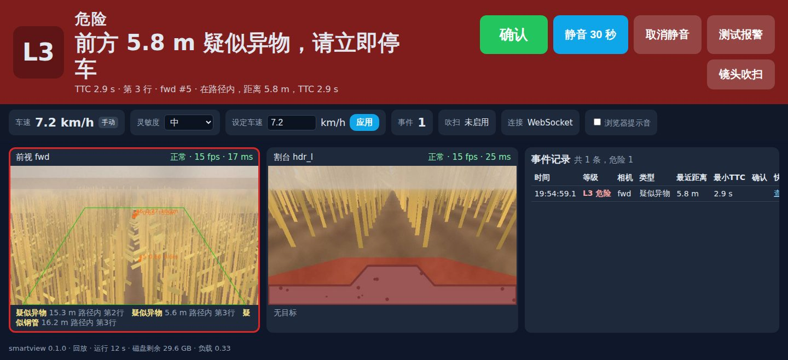

# smartview — 玉米收获机垄内异物视觉预警系统

基于车载视觉的实时预警系统：在玉米收获作业中提前发现垄内隐藏的 **石块、8 寸机井井口钢管、桩体** 等异物，
通过驾驶室声光报警与触摸屏 HMI 提醒驾驶员减速停车，避免割台（摘穗辊 / 切碎器）损坏。

- **硬件**：驾驶室顶前视相机（5~20 m）+ 割台分禾器近场相机（0.3~3 m）+ NVIDIA Jetson Orin NX 车规整机 + 蜂鸣器/灯条 + 10.1" 触摸屏 + 镜头风刀吹扫
- **软件**：GMSL2 采集 → 有效区域（ROI − 割台排除区）→ YOLO/TensorRT 检测 → 跟踪 → 地面几何测距/TTC → 四级报警状态机 → 声光 / HMI / 事件记录
- **本仓库交付**：中文方案文档（硬件 + 软件）+ **可运行的软件原型**（合成场景离线即可跑通全链路，CPU 即可测试）



## 文档

| 文档 | 内容 |
|---|---|
| [00 总体方案](docs/00-总体方案.md) | 背景、KPI、设计输入、架构、四级报警、决策与风险、路线图 |
| [10 硬件方案与 BOM](docs/10-硬件方案与BOM.md) | 整机 / 相机 / 吹扫 / 报警 / 供电选型，安装与标定，BOM |
| [20 软件架构](docs/20-软件架构.md) | 模块、数据流、线程模型、配置、报警状态机、事件、HMI、部署、二期 CAN 接口 |
| [30 感知算法与数据方案](docs/30-感知算法与数据方案.md) | 类别与标注、模型选型与算力、跟踪、测距、数据采集/增强/训练/部署、评估与数据飞轮 |
| [40 田间测试与验收](docs/40-田间测试与验收.md) | 测试层级、场地矩阵、田间测试、故障注入、验收门限 |

## 快速开始（开发机，无需 GPU）

```bash
python3 -m venv .venv && . .venv/bin/activate      # Python 3.10 / 3.11
pip install -e ".[dev,onnx]"

# 一键演示：合成玉米垄场景 → 检测 → 跟踪 → 测距 → L1/L2/L3 报警 → 事件库与片段
smartview demo --out data/demo
# 带驾驶室 HMI（浏览器打开 http://127.0.0.1:8080/ ，可点"确认 / 静音 / 测试报警"）
smartview demo --out data/demo --hmi --realtime --scenario mixed_forward

# 回放任意配置 / 视频，输出逐帧 JSONL 供评估
smartview replay -c configs/replay_synthetic.yaml --no-hmi --log-detections /tmp/dets.jsonl
python training/evaluate_field.py --dets /tmp/dets.jsonl --synthetic pipe_forward --config configs/replay_synthetic.yaml --cam fwd

# 测试与静态检查
pytest -q && ruff check .
```

演示输出示例（合成场景，车速 2 m/s，井管从 18 m 处接近）：

```
t=   3.20s [L2 警告] 前方 11.3 m 疑似异物，请减速准备停车（fwd #6）
t=   5.87s [L3 危险] 前方 5.7 m 疑似钢管，请立即停车（fwd #10）
事件 1 开始 … 事件 1 结束（快照 + 前 5 s / 后 3 s 片段已写入 data/demo/clips）
```

## 在普通电脑 / 虚拟机 / Docker 中运行

原型不依赖 GPU、相机或 Jetson：任何 Linux 虚拟机（VirtualBox / VMware / Hyper-V / WSL2 / 云主机，推荐 Ubuntu 22.04+）
给 ≥2 vCPU、≥2 GB 内存、≥2 GB 磁盘即可跑全部测试、演示与 HMI。

```bash
# 虚拟机内
git clone <本仓库> smartview && cd smartview
python3 -m venv .venv && . .venv/bin/activate && pip install -e ".[dev,onnx]"
smartview demo --hmi --realtime --loop --scenario mixed_forward   # 循环播放，Ctrl-C 退出
# 宿主机浏览器打开 http://<虚拟机IP>:8080/ （VirtualBox NAT 需添加端口转发 8080→8080，或改桥接网络；WSL2 直接 localhost:8080）

# Docker（宿主机）
docker build -t smartview . && docker run --rm -p 8080:8080 smartview
```

- 回放自己的视频：在配置里把 `source` 改为视频路径（`source: /videos/field.mp4`），`mount` 填相机大致安装参数即可；USB 摄像头经 VirtualBox/VMware USB 直通后用 `v4l2:/dev/video0`，网络相机用 `rtsp://...`。
- 性能：4 vCPU 下合成场景约 0.5× 实时（开销主要在渲染合成画面，回放真实视频无此开销）；不加 `--realtime` 则全速跑。
- 虚拟机里不可用的部分：GPIO（自动退化为只记录日志的 `FakeGpioDriver`）、TensorRT（用 `detector.backend: onnx` 代替）、GMSL2 相机、音频播放（无 `aplay` 时自动停用，蜂鸣器本就在真机 GPIO 上）。
- Windows 原生运行理论可行（依赖均有 Windows 轮子），未经测试；推荐 WSL2。

## 真机部署（Jetson Orin，JetPack 6.x）

```bash
sudo bash scripts/install_jetson.sh                 # 依赖、用户、/opt/smartview、systemd
sudo vi /etc/smartview/config.yaml                  # 相机管线 / 安装外参 / GPIO 引脚（模板：configs/jetson_4row.yaml）
python scripts/calibrate_homography.py --image fwd.jpg          # 地面单应性（5/10/15/20 m 标志物）
smartview calib-mask --video header_drive.mp4 --out /etc/smartview/masks/hdr_l.png   # 学习割台/分禾器排除区
bash training/export_trt.sh models/smartview.onnx /opt/smartview/models/smartview_fp16.engine fp16
smartview selftest -c /etc/smartview/config.yaml && sudo systemctl start smartview
```

## 仓库结构

```
docs/            五篇中文方案文档
configs/         replay_synthetic.yaml（离线演示）、jetson_4row.yaml / jetson_6row.yaml（真机模板）
src/smartview/   边缘端软件：capture · detect · track · geometry · risk · alarm · storage · health · hmi · pipeline · synth · tools
training/        数据整理、copy-paste 合成、训练 / 导出 ONNX / TensorRT、INT8 校准、田间评估
scripts/         Jetson 安装脚本、systemd 单元、单应性标定、合成演示视频、提示音生成
tests/           单元 + 端到端集成（合成场景）+ HMI 接口测试（CI：Python 3.10 / 3.11）
assets/sounds/   三级提示音（中文语音可自备）
```

## 关键设计点

- **四级报警**（L0 正常 / L1 注意 / L2 警告 / L3 危险）：按在路判定、距离、TTC、类别权重分级，升级即时、降级滞回，确认/静音语义明确，多相机同时确认自动升级。
- **识别区域剔除割台**：每相机配置排除多边形或像素遮罩，`smartview calib-mask` 可从行驶视频自动学习静止的割台/分禾器区域；集成测试证明不剔除会误报、剔除后不误报。
- **镜头吹扫**：风刀 + 电磁阀，定时 / 镜头脏污检测 / HMI 手动触发，占空比保护，吹扫期间抑制该相机检测。
- **远处小目标**：前视 1080p 中心裁剪推理，避免整帧缩放丢失 15 m 处 ~17 px 的石块。
- **离线可验证**：内置合成玉米垄场景与逐帧真值，无真实数据也能确定性回归全链路（首报距离、测距误差、误报）。

## 状态与许可证

- 原型在合成场景下验证了软件逻辑；**真实田间指标需用真实数据训练的模型验证**（见 docs/40）。
- Jetson 相关（GMSL2 管线、GPIO 引脚、TensorRT 后端、音频）未在真机验证，代码与配置中已标注。
- 本仓库代码 Apache-2.0；训练若使用 Ultralytics（AGPL-3.0）需注意商用授权，见 `training/README.md`。
