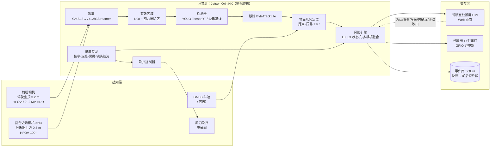

# 00 · 总体方案 — 玉米收获机垄内异物视觉预警系统（smartview）

> 文档集：[00 总体方案](00-总体方案.md) · [10 硬件方案与 BOM](10-硬件方案与BOM.md) · [20 软件架构](20-软件架构.md) · [30 感知算法与数据方案](30-感知算法与数据方案.md) · [40 田间测试与验收](40-田间测试与验收.md)

## 1. 背景与痛点

玉米机收时，割台（分禾器 → 拨禾链 → 摘穗辊/摘穗板 → 升运器 → 切碎还田器）在 2~3 m 高的秸秆中前进，驾驶员几乎看不到垄内地面。田间常见的隐藏异物：

| 异物 | 典型尺寸 | 来源 | 后果 |
|---|---|---|---|
| 机井井口钢管（8 寸，外径 219.1 mm） | 井台高出地面 0.3~0.8 m（江苏高标准农田规范），常带混凝土井台；旧井露头 0.1~0.6 m 不等 | 华北平原灌溉机井，位置固定但逐年被作物遮蔽 | 顶弯/撕裂分禾器，卡死摘穗辊，打断切碎刀，严重时损坏变速箱 |
| 石块 | 10~40 cm | 河滩地、新开垦地、修路遗落 | 摘穗辊、切碎刀崩刃，轴承冲击损坏 |
| 水泥桩 / 铁桩 / 界桩 | 10~30 cm，高 0.3~1.2 m | 地界、电线拉线、测量桩 | 同上，铁桩尤甚 |
| 遗留农机具、钢筋、树桩 | 不定 | 上季遗落 | 卷入传动系统 |
| 人 / 动物 | — | 抢收期间地头作业人员、家畜 | 人身安全 |

一次割台事故通常意味着 1~3 天停机加数千到数万元维修费，而玉米收获窗口期只有 2~3 周，误工损失远大于维修费本身。**预警的价值在于让驾驶员提前 ≥2.5 s 减速停车或抬升割台**。

## 2. 目标与关键指标（KPI）

| # | 指标 | 目标值 | 验证方式（见 [40 测试与验收](40-田间测试与验收.md)） |
|---|---|---|---|
| K1 | 井口钢管（Ø219 mm，露出 ≥0.2 m）在 ≥3 m 处的检出率 | ≥98 % | 静态场地 + 田间动态测试，按距离分桶统计 |
| K2 | ≥15 cm 石块在 ≥3 m 处的检出率 | ≥90 % | 同上 |
| K3 | 前视预警时间（首次 L2 到割台接触） | ≥2.5 s（2 m/s 时 ≥5 m） | 回放真值 / 田间计时 |
| K4 | 误报率（≥L2 且无真实异物） | ≤1 次 / 小时 | 田间连续作业统计 |
| K5 | 端到端延迟（曝光 → 报警输出） | ≤150 ms | 示波器 / LED 闪烁法 |
| K6 | 割台自身零误报 | 0 | 行驶测试，排除区生效 |
| K7 | 粉尘工况可用性 | 连续作业 8 h，镜头脏污自动吹扫，无需人工擦拭 | 田间 |
| K8 | 测距误差（5~15 m） | 中位 ≤10 %，90 分位 ≤15 % | 合成回放 + 场地标志物 |

软件原型在合成场景下已达到：首次 L2 时目标距离 ≈11 m（预警 ≈5.6 s）、首次 L3 ≈5.7 m、误报 0、测距中位误差 <10 %（`pytest tests/test_integration_synthetic.py`）。**真实田间指标需用真实数据训练后的模型验证**，合成场景只验证软件逻辑。

## 3. 作业场景与设计输入

| 项目 | 取值 | 说明 |
|---|---|---|
| 机型 | 自走式摘穗型玉米收获机，4 行（默认）/ 6 行 | 行距 0.6 m（农业农村部黄淮海意见：60 cm 等行距；雷沃 CP04 为 650 mm）；割台宽 2.4~2.6 / 3.6~3.9 m，按实车配置 |
| 作业速度 | 3~8 km/h（0.8~2.2 m/s）；农业农村部减损意见推荐 4~6 km/h | TTC 计算用实时车速（GNSS）或驾驶员设定 |
| 反应链 | 驾驶员反应 ~1 s + 减速/停车或抬割台 ~1~1.5 s | → 需要 **≥2.5 s** 预警，2 m/s 时 ≥5 m |
| 作物状态 | 秸秆 2~3 m，叶片干枯；垄底 0~0.5 m 相对通透 | 前视只能沿垄沟"看进去"，近场相机贴地看垄底 |
| 环境 | 粉尘极大、振动大、顺光/逆光/黄昏、偶有夜间 | 相机 HDR、风刀吹扫、镜头脏污检测 |
| 供电 | 车载 12/24 V，熄火断电 | 隔离 DC-DC + 延时关机 |

**预警距离推导**：$d_{warn} = v \cdot (t_{react} + t_{stop}) = 2.0 \times 2.5 = 5\,\text{m}$。前视相机覆盖 5~20 m 负责主预警；割台近场相机覆盖 0.3~3 m，是"最后一道提示"（≤1.5 s），对低速作业与前视漏检兜底，并在二期可直接触发割台离合切断。

## 4. 系统总体架构

数据流与线程模型详见 [20 软件架构](20-软件架构.md)。一期不接入车辆控制；二期通过 CAN/继电器实现割台离合切断、升割台、停车（接口预留见 20 第 10 节）。

## 5. 感知布局与覆盖

| 相机 | 安装 | 视场 | 覆盖地面 | 分辨能力 | 职责 |
|---|---|---|---|---|---|
| 前视 fwd | 驾驶室顶中线，高 3.2 m，俯角 15° | HFOV 60°，1920×1080 | 约 2.4 m 至地平线（有效关注 5~20 m） | 15 m 处 ≈0.9 cm/px，Ø219 mm 钢管 ≈24 px 宽、0.5 m 高 ≈55 px | 主预警（L1/L2/L3），人/动物，冠层缺口线索 |
| 割台 hdr_l / hdr_r（6 行机加 hdr_c） | 分禾器上方 0.5 m，横向 ±0.6 m（6 行 ±1.2 m / 0），俯角 25° | HFOV 100°，1920×1080 | 约 0.3 m 起，重点 0.5~3 m | 3 m 处 ≈0.37 cm/px，15 cm 石块 ≈40 px | 近场兜底（直接 L3），前视漏检与低速作业保护 |

几何由同一套针孔模型计算（`smartview.geometry.PinholeCamera`），合成场景与真机定位共用，详见 [10 硬件方案](10-硬件方案与BOM.md) 第 3 节。**前视相机不能整帧缩放到 640 再检测**：15 cm 石块在 15 m 处 1080p 约 17 px、缩到 640×360 后仅约 5 px，因此配置 `detect_crop` 只对覆盖 5~20 m 的中心区域做推理（或分块推理）。

## 6. 四级状态与驾驶员操作

| 等级 | 名称 | 触发（摘要，完整规则见 20 §6） | 输出 | 驾驶员动作 |
|---|---|---|---|---|
| L0 | 正常 | 无目标 | 灰色横幅 | — |
| L1 | 注意 | 邻近路径或未确认目标；传感器故障（镜头脏污/离线） | 黄色横幅 + 黄灯 | 关注画面，必要时减速 |
| L2 | 警告 | 路径内确认目标，距离 ≤12 m 或 TTC ≤6 s | 橙色横幅 + 红灯 + 间歇蜂鸣 + 语音"前方有异物，请减速" | 减速，准备停车 |
| L3 | 危险 | 路径内确认目标，距离 ≤6 m 或 TTC ≤3 s；割台相机路径内确认；人/动物 ≤10 m；两相机同时确认 | 红色闪烁横幅 + 红灯 + 连续蜂鸣 + 语音"请立即停车" | 立即停车 / 抬升割台 |

- **确认（ack）**：停止当前事件的蜂鸣，灯与横幅保留；出现更高等级或新目标自动重新报警。
- **静音**：最多 60 s，仅静音声音，视觉保留。
- **滞回**：升级即时；降级需支撑条件消失满 1/2/3 s（L1/L2/L3），避免抖动。
- **传感器故障**：相机离线/冻结/黑屏/镜头脏污时至少保持 L1 视觉提示并写明原因，镜头脏污自动触发吹扫。
- **吹扫期间**：对应相机的检测暂停提交（气流扬尘会误检），HMI 显示"吹扫中"。

## 7. 关键设计决策

| 决策 | 选择 | 理由 |
|---|---|---|
| 感知方式 | 仅车载视觉（前视 + 割台近场），不做无人机建图 | 用户决策；部署简单、单机闭环；无人机/RTK 建图作为三期增强 |
| 计算平台 | Jetson Orin NX 16GB 车规整机 | TensorRT + GMSL2 生态成熟，4 路 1080p 15~20 fps 有余量；RK3588 为量产降本备选 |
| 模型 | YOLO 系列（训练用 Ultralytics，量产评估 Apache-2.0 架构） | 小目标实时检测的成熟方案；AGPL 许可证风险见 30 §3 |
| 远处小目标 | 前视中心裁剪 `detect_crop` + 1080p 输入 | 保住 15 m 处 ~17 px 的石块 |
| 割台自遮挡 | 每相机 `exclude_polygons` / 像素遮罩，自动学习工具 `smartview calib-mask` | 割台在画面中静止、像异物，不剔除必误报（集成测试已验证） |
| 粉尘 | 环形气幕 + 定时/脏污触发脉冲吹扫 + 疏水镀膜；国内收获机多无空压机，系统自带 24 V 气泵 | 玉米收获粉尘极大，人工擦拭不可持续 |
| 报警去抖 | 轨迹确认（≥3 帧）+ 滞回 + 冷却合并 + 多相机升级 | 既要早报，也要避免"报警疲劳" |
| 测距 | 地面单应性 + 目标脚点 + 车速 TTC | 单目即可满足 10 % 精度；脚点遮挡导致偏大为不安全方向，用割台相机兜底 |
| 离线可验证 | 合成玉米垄场景 + 确定性回放 | 没有真实数据也能跑通并回归全链路 |

## 8. 局限与风险

| 风险 | 影响 | 缓解 |
|---|---|---|
| 秸秆/叶片遮挡 | 前视看不到垄内地面，预警距离缩短 | 沿垄沟中线安装；割台相机兜底；二期无人机建图 |
| 粉尘 / 雾化 | 远处对比度下降，误检漏检 | HDR 相机、风刀、相对阈值、镜头脏污检测与自动吹扫 |
| 夜间 | 前视距离下降 | 近场 LED 补光；夜间以割台相机为主并提示降速 |
| 脚点被遮挡 | 测距偏大（不安全方向） | 距离变化率交叉校验、割台相机、保守阈值 |
| 俯仰振动 ±3° | 15 m 处测距误差 ≈20 % | 滞回与 EMA 平滑；二期 IMU 补偿 |
| 报警疲劳 | 驾驶员忽视报警 | 严格的确认/滞回/冷却；误报率 KPI；灵敏度档位 |
| 域偏移 | 不同地块/品种/相机导致模型退化 | 数据飞轮：事件片段回标，持续迭代（30 §7） |
| 合成场景 ≠ 真实 | 原型指标不代表田间指标 | 文档明示；田间验收以真实数据为准 |

## 9. 路线图

| 阶段 | 内容 | 产出 |
|---|---|---|
| 一期（本方案） | 前视 + 割台视觉检测，声光报警 + HMI + 事件记录，镜头吹扫，割台区域剔除 | 原型机 1~2 台，田间验收报告 |
| 二期 | CAN/继电器自动干预（割台离合切断、升割台、停车），IMU 俯仰补偿，INT8 量化，RK3588 降本评估 | 量产样机 |
| 三期（可选） | 收割前无人机巡检建图 + RTK 定位预警、事件记忆地图（井口位置逐年复用）、毫米波/金属探测兜底、车队云平台与 OTA | 产品化 |

## 10. 交付物清单

| 类别 | 内容 |
|---|---|
| 文档 | 本文档集 5 篇（总体、硬件与 BOM、软件架构、算法与数据、测试与验收） |
| 软件原型 | `src/smartview`：采集、检测（经典基线 / ONNX / TensorRT）、跟踪、几何定位、风险引擎、报警输出（控制台/声音/GPIO/HMI）、吹扫控制、事件库与片段、健康监测、中文 Web HMI、合成场景与 CLI |
| 配置 | `configs/replay_synthetic.yaml`（离线演示）、`configs/jetson_4row.yaml`、`configs/jetson_6row.yaml`（真机模板） |
| 训练工具 | `training/`：数据整理、copy-paste 合成、训练/导出、INT8 校准、田间评估 |
| 部署 | `scripts/install_jetson.sh`、`smartview.service`、地面单应性与割台遮罩标定工具 |
| 测试 | `tests/`：单元 + 集成（合成场景端到端）+ HMI 接口，CI 覆盖 Python 3.10/3.11 |
