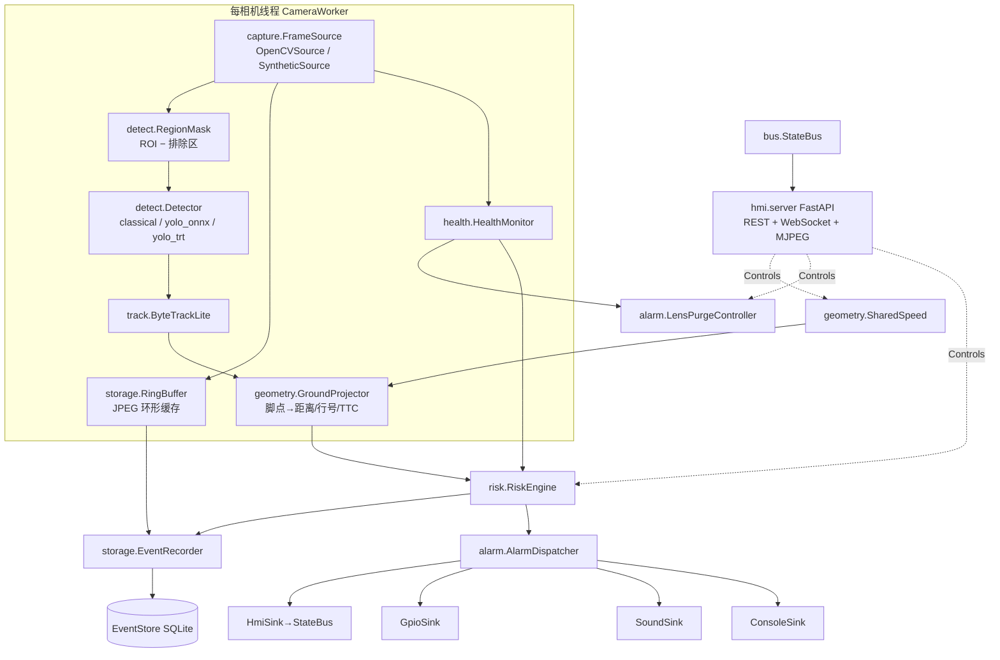
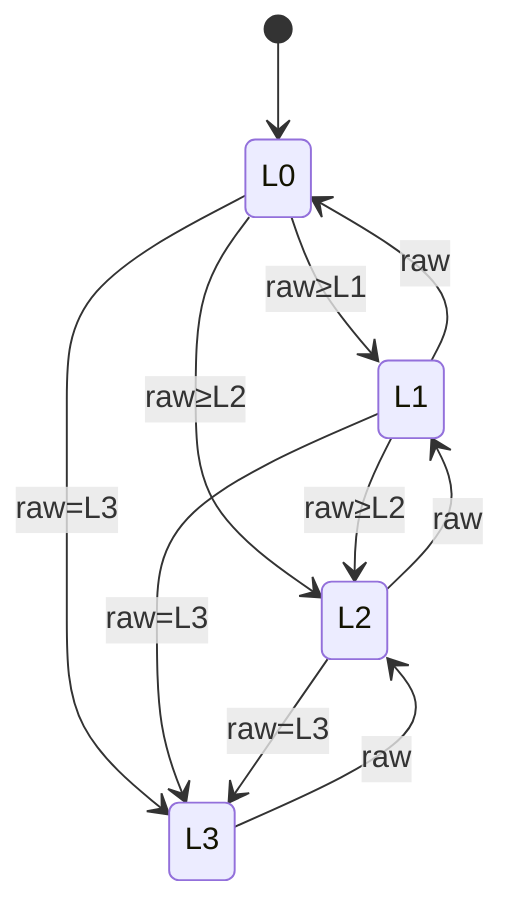

# 20 · 软件架构

> 对应代码：`src/smartview/`。本篇描述边缘端软件的模块、数据流、线程模型、报警状态机、HMI、事件记录、部署与二期接口。

## 1. 模块总览

| 包 | 职责 | 关键类 / 函数 |
|---|---|---|
| `config` | pydantic v2 配置模型，YAML 加载，未知字段报错 | `SmartViewConfig.load()` |
| `types` | 跨模块数据类型 | `Frame, Detection, Track, GroundPoint, RiskAssessment, AlarmState, Event, CamHealth, AlarmLevel` |
| `clock` | 单调时钟抽象（真机 `MonotonicClock`，回放/测试 `ReplayClock`） | 所有时长逻辑只用它 |
| `capture` | 帧源 | `OpenCVSource`（文件 / `v4l2:` / `gst:` / RTSP，直播只取最新帧），`SyntheticSource` |
| `detect` | 有效区域、检测后端、YOLO 通用后处理 | `RegionMask`, `ClassicalDetector`, `YoloOnnxDetector`, `YoloTrtDetector`, `postprocess.decode_yolo/nms_numpy` |
| `track` | 轻量多目标跟踪 | `ByteTrackLite`（两段贪心 IoU + 小框中心距离兜底 + 常速预测） |
| `geometry` | 针孔相机 / 单应性 / 车体定位 / 车速 | `PinholeCamera`, `GroundProjector`, `ManualSpeed`, `NmeaSpeed`, `SharedSpeed` |
| `risk` | 分级规则（纯函数）与状态机 | `rules.assess_track`, `RiskEngine` |
| `alarm` | 报警分发与输出、GPIO、吹扫 | `AlarmDispatcher`, `ConsoleSink/SoundSink/GpioSink/HmiSink`, `LensPurgeController` |
| `storage` | 事件库、环形缓存、片段、事件记录器 | `EventStore`, `RingBuffer`, `write_clip`, `EventRecorder` |
| `health` | 相机健康与镜头脏污 | `HealthMonitor` |
| `bus` | 版本化共享状态（HMI 数据源） | `StateBus`, `CamSnapshot` |
| `hmi` | FastAPI 服务 + 单页中文 UI | `create_app()` |
| `pipeline` | 装配与运行模式 | `CameraWorker`, `SmartViewApp.run_sync/run_threaded`, `Controls` |
| `synth` | 合成玉米垄场景与真值 | `SyntheticScene`, `make_scene`, `SCENARIOS` |
| `tools` | 标定工具 | `selfmask.learn_static_mask`, `homography.solve_homography` |
| `cli` | 命令行 | `run / replay / demo / synth / calib-mask / export-events / selftest / bench` |

## 2. 数据流（单帧）

1. `FrameSource.read()` → `Frame(cam_id, seq, ts, image)`；直播 `ts = monotonic`，回放 `ts = i / fps`。
2. `HealthMonitor.observe()`：帧率、冻结、黑屏、分块镜头脏污 → 变化时 `RiskEngine.set_sensor_fault()`；脏污 → `LensPurgeController.on_lens_dirty()`。
3. `RingBuffer.push()`：按 10 fps 抽样存 JPEG（≤960 px 宽），供事件前滚。
4. 若该相机处于吹扫窗口（burst + 0.5 s）：跳过 4~7，快照标记 `purging`。
5. 检测：前视 YOLO 后端在 `detect_crop` 裁剪区内推理并映射回全帧；经典基线在全帧（内部按掩膜）；`RegionMask.filter()` 丢弃脚点不在有效区或与排除区重叠 >50 % 的框。
6. `ByteTrackLite.update()` → 已确认轨迹；`GroundProjector.annotate()` 由框底边中点反投影得 `(x_fwd, y_lat)`、行号、是否在路；距离做 EMA，距离变化率最小二乘，`TTC = dist / max(v, 0.3)`。
7. `RiskEngine.update(cam_id, tracks)` → 每条轨迹 `RiskAssessment` → 全局 `AlarmState`。
8. 变化时通知订阅者：`AlarmDispatcher`（输出端）、`EventRecorder`（事件）、`SmartViewApp.timeline`（测试）。
9. ≤8 fps 生成叠加画面 JPEG（框、距离、ROI/排除区着色）→ `StateBus.set_cam()`，HMI 通过 MJPEG / WebSocket 读取。

## 3. 线程 / 进程模型

**真机（`run_threaded`）**

| 线程 | 内容 | 频率 |
|---|---|---|
| `cam-<id>` ×N | 读帧 → 第 2 节全流程 | 相机帧率（15~30 fps） |
| `alarm-dispatch` | 队列消费，调用各 sink；无变化时每 1 s 重发（GPIO 幂等） | 事件驱动 |
| `gpio-pattern` | 间歇蜂鸣相位输出 | 10 Hz |
| `housekeeping` | `RiskEngine.tick`、`EventRecorder.tick`（后滚到期写片段）、`LensPurgeController.tick`（定时/结束）、离线检测、系统信息 | 5 Hz |
| `nmea-speed` | 串口读取 `$..RMC` | 串口速率 |
| `hmi` | uvicorn（FastAPI），不安装信号处理 | — |
| 主线程 | 等待停止信号；`SIGINT/SIGTERM` → 优雅退出 | — |

共享状态只有 `RiskEngine`（RLock）、`StateBus`（Condition）、`EventStore`（RLock + 单连接）与 `SharedSpeed`（Lock）。OpenCV / onnxruntime / TensorRT 推理释放 GIL，Orin 的 8 核足够 3~4 路。

**优雅退出**：`stop_event` → 相机线程 join（5 s）→ 分发器 flush 并关闭 sink（GPIO 全部关断，`atexit` 兜底）→ 记录器写出未完成片段 → 吹扫阀关闭 → HMI `should_exit` → 关闭数据库。

**回放（`run_sync`）**：在调用线程 lockstep 推进所有相机（每轮每相机一帧），`ReplayClock` 跟随帧时间戳，输出端同步直达；`--realtime` 时按时间戳节拍睡眠；结束后推进时钟完成后滚并写片段。测试全部使用该模式，保证确定性。

## 4. 配置结构

见 `configs/replay_synthetic.yaml`（离线）与 `configs/jetson_4row.yaml`（真机）。要点：

| 段 | 字段 | 说明 |
|---|---|---|
| `machine` | `n_rows, row_spacing_m, header_width_m, path_margin_m` | 行号与"在路"判定（`|y_lat| ≤ header_width/2 + margin`） |
| `speed` | `source: manual|nmea, manual_mps, nmea_port, stale_s, min_speed_mps` | GNSS 失锁 3 s 回退手动值 |
| `cameras[]` | `id, role(forward|header), source, width, height, fps` | `source`：文件 / `synthetic:<scenario>` / `gst:<pipeline>` / `v4l2:/dev/videoN` / `rtsp://` |
| | `mount{x_fwd_m,y_lat_m,z_m,pitch_deg,yaw_deg,roll_deg,hfov_deg}` | 外参，`x_fwd_m` 相对割台前缘 |
| | `homography` | 标定的 3×3（像素→地面），优先于 mount |
| | `detect_crop` | 前视中心裁剪（归一化 x0,y0,x1,y1） |
| | `roi_polygon` / `exclude_polygons` / `exclude_mask_png` | 有效区 = ROI − 排除区（割台/机身） |
| | `rows_covered, purge_channel` | 多相机融合与吹扫通道 |
| `detector` | `backend: classical|onnx|tensorrt, model_path, classes, input_size, conf_thr, iou_thr, num_threads` | `model.json` 自动提供类别/尺寸 |
| `tracker` | `min_hits, max_age, conf_high, conf_low, iou_high, iou_low, dist_ema` | |
| `risk` | `sensitivity, hold_s{L1,L2,L3}, cooldown_s, mute_max_s, class_weights, thresholds{...}` | 阈值全部可调 |
| `alarm` | `sinks[], gpio{buzzer_pin,lamp_pin,lamp_yellow_pin,active_high,mode}, sound{player,wav_dir}, purge{enabled,channels,burst_s,period_s,on_dirty,min_interval_s,max_duty}` | |
| `storage` | `db_path, clip_dir, pre_roll_s, post_roll_s, max_disk_gb, ring_fps, ring_max_width` | 相对路径按配置文件目录解析 |
| `hmi` | `enabled, host, port, mjpeg_fps, jpeg_quality` | |

## 5. 几何定位

- 车体系：原点为割台前缘中心地面投影，x 前、y 左、z 上。
- `PinholeCamera.from_mount()` 由 HFOV 与分辨率得内参（方形像素），旋转 `R = Rz(roll)·Rx(pitch)·R0·Rz(−yaw)`。
- 像素 → 地面：视线与 z=0 平面求交；地平线以上返回 None。标定路径用 3×3 单应性（`scripts/calibrate_homography.py`，≥4 个 5/10/15/20 m 标志物），分辨率变化自动缩放。
- 行号：`row = round((n_rows−1)/2 − y_lat/row_spacing)`，从左到右 0..n−1，可越界表示机外。
- 尺度门限（经典基线）：由同一模型给出图像行 v 处 0.10~0.70 m 物体的期望像素高度。
- 误差来源：脚点被秸秆遮挡（偏大）、俯仰振动（±3° 在 15 m ≈20 %）、标定误差。缓解：EMA + 距离变化率、割台相机兜底、二期 IMU。

## 6. 报警状态机

分级规则（`risk/rules.py`，灵敏度 低/中/高 → 置信度 0.45/0.35/0.25、确认帧数 4/3/2）：

| 相机 | L1 | L2 | L3 |
|---|---|---|---|
| 前视 | 邻近/在路、hits ≥2、d ≤20 m | 在路且确认，(d ≤12 m 或 TTC ≤6 s)，score·w ≥0.4 | 在路且确认，(d ≤6 m 或 TTC ≤3 s)；人/动物在路 d ≤10 m |
| 割台 | 确认但不在路、不邻近 | 邻近路径且确认（d ≤3 m）；在路但 d >3 m | 在路且确认且 d ≤3 m |

类别权重：`well_pipe 1.2, person 1.5, stone/stake/concrete_pile 1.0, pipe_like 1.0, animal 0.8, unknown_obstacle 0.6`。

引擎逻辑（`risk/engine.py`）：

- `raw` = 各相机（1.5 s 内有更新）最高等级；**多相机升级**：≥2 相机同时 ≥L2，或前视 L2 且覆盖同一行的割台相机 ≥L1 → +1（封顶 L3）。
- 相机记录过期（线程停摆）时，保持期从最后一条记录过期时起算，不会无限保持。
- `ack()`：蜂鸣停止、灯/横幅保留；等级升高或顶级目标换 ID 时自动重新武装。`mute(s)`：≤ `mute_max_s`。
- `sensor_fault`：任一相机故障 → 至少 L1，并给出中文原因。
- `test_alarm(level)`：HMI 测试按钮，注入虚拟评估，约 1.5 s 后随滞回自动消失。
- 输出：`buzzer_on = level ≥ L2 ∧ ¬acked ∧ ¬muted`；`lamp_on = level ≥ L2`；黄灯 = L1。GPIO 模式：L3 蜂鸣连续，L2 0.5 s 通/断。

## 7. 事件记录

- ≥L2 且无进行中事件 → 新建事件（墙上时间、等级、相机、类别、距离、TTC、车速、原因），保存触发相机最新 JPEG 快照，登记 **前滚 5 s + 后滚 3 s** 片段任务；后滚到期由 `tick()` 从环形缓存取帧写 MJPG AVI（Jetson 可改 GStreamer H.264）。
- 进行中：更新 `level_max / dist_min / ttc_min`。
- 降到 <L2：关闭（`ts_end`）。**冷却合并**：5 s 内同一轨迹或距离差 ≤1 m 的目标再次触发 → 延续原事件而非新建。
- `ack` 写入事件；吹扫写 `purge_log`。
- 磁盘：片段目录超过 `max_disk_gb` 时按最旧删除。
- 导出：`smartview export-events -c cfg --out events.csv`；HMI 可查看快照 / 下载片段。

## 8. 健康监测与吹扫

- 冻结：缩略图帧差均值 <0.5 持续 2 s；黑屏：亮度 <15；离线：>2 s 无帧。
- 镜头脏污（分块 16×10）：某块清晰度相对自身 60 s 基线 <0.3 **且** 块内静止像素占比 >0.5（污点不随地面流动）→ 脏块；脏块占比 ≥15 % → `lens_dirty`。
- 吹扫控制：定时（默认 60 s 一次 1.5 s）+ 脏污触发 + HMI 手动；最小间隔 10 s；600 s 滑动窗口占空比 ≤10 %（保护电磁阀/气源）；吹扫窗口内对应相机不提交检测；事件库记录每次吹扫。

## 9. HMI

| 接口 | 作用 |
|---|---|
| `GET /` | 单页中文界面（无外部依赖） |
| `GET /api/state` | 全量状态（报警、各相机等级/轨迹/健康、车速、吹扫、系统、设置） |
| `WS /ws` | 状态变化推送（≤5 Hz），前端断线自动重连并退化为 500 ms 轮询 |
| `GET /stream/{cam}.mjpg` / `GET /api/cam/{cam}.jpg` | MJPEG 流 / 单帧（`?stream=jpg` 低带宽模式） |
| `POST /api/ack` `POST /api/mute {seconds}` `POST /api/unmute` | 确认 / 静音 |
| `GET|PUT /api/settings` | 车速（km/h）、车速来源、灵敏度（pydantic 校验，非法 422） |
| `POST /api/test-alarm {level}` | 测试报警 |
| `GET|POST /api/purge` | 吹扫状态 / 手动吹扫 |
| `GET /api/events[...]` | 事件列表 / 详情 / 快照 / 片段 |
| `GET /api/health` | 相机健康 |

页面：全宽报警横幅（灰/黄/橙/红，L3 闪烁，大字中文提示如"前方 6.2 m 井口钢管，请立即停车"）、确认/静音/测试/吹扫大按钮、车速与来源徽标、灵敏度选择、相机网格（叠框画面 + fps/健康/推理耗时 + 轨迹列表）、事件表、页脚系统信息；可选浏览器蜂鸣冗余。触摸屏以浏览器 kiosk 模式全屏打开。

## 10. 部署与运维

- `scripts/install_jetson.sh`：系统依赖（含带 GStreamer 的系统 OpenCV、alsa、CJK 字体）、`smartview` 用户（gpio/video/dialout 组）、`/opt/smartview` 虚拟环境（`--system-site-packages` 以使用 JetPack 的 cv2/tensorrt）、`/etc/smartview/config.yaml`、systemd 服务（`Restart=always`，`TimeoutStopSec=10` 配合掉电延时）。
- 自检：`smartview selftest -c /etc/smartview/config.yaml`（相机可读、检测器可用、GPIO 模式）。
- 日志：journald；逐帧 JSONL（`--log-detections`）用于评估与回标。
- OTA：模型文件 + 配置原子替换后 `systemctl restart smartview`；二期可接车队云。
- 性能预算（Orin NX 16GB，YOLOv8s@640 FP16 约 5~8 ms/帧）：1 路前视 20 fps + 2~3 路割台 15 fps 合计 ≤60 fps 推理，GPU 占用 <50 %；CPU 负责解码/后处理/HMI。

## 11. 二期接口预留（车辆控制）

- `AlarmSink` 增加 `CanActuatorSink`：L3 持续 ≥0.3 s 且驾驶员未确认 → 发送割台离合切断 / 升割台 / 停车请求（ISOBUS 或厂商私有 CAN 报文，需与主机厂联调）；带独立看门狗与"人工优先"开关。
- Orin 自带 2 路 CAN 控制器（`can0/can1`，SocketCAN）；继电器通道可作为无 CAN 车型的离合切断备选。
- 安全要求：自动干预仅在车速 ≤8 km/h 生效；任何传感器故障下禁止自动干预，仅提示。
