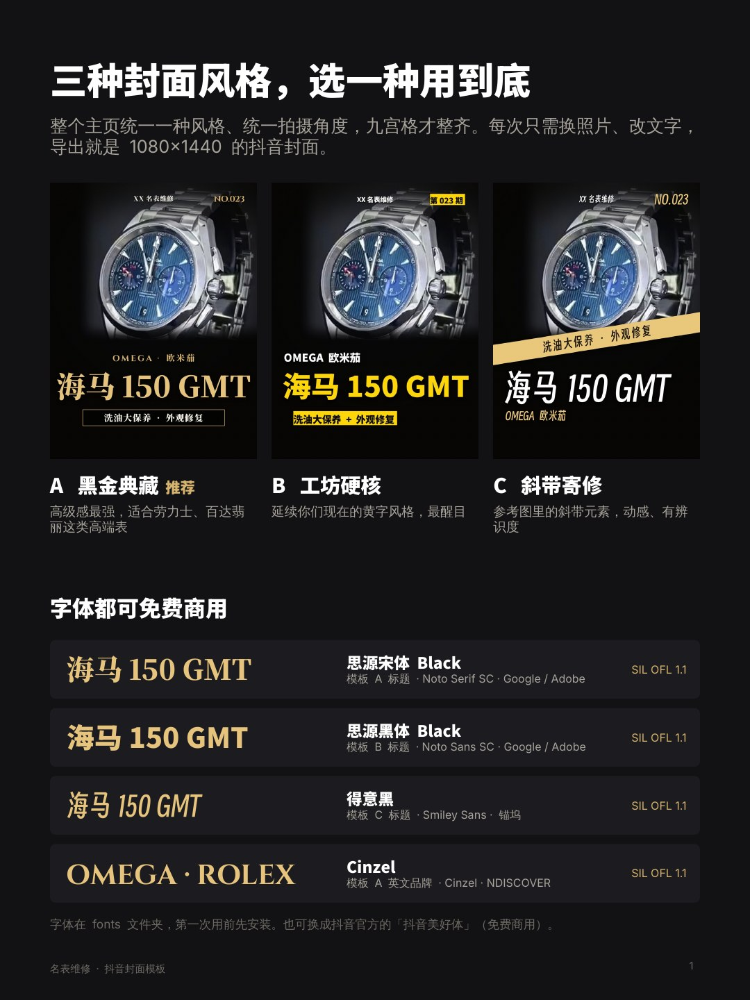

# 名表维修 · 抖音封面模板

给名表维修抖音号用的主页封面模板。用 PowerPoint 或 WPS 打开，换照片、改文字，导出就是 1080×1440（3:4）的抖音封面。



## 文件说明

| 文件 | 用途 |
|---|---|
| `抖音封面模板.pptx` | 模板本体。第 1–4 页是说明，第 5–7 页是三种风格的封面模板 |
| `fonts/` | 模板用到的 4 个字体，第一次使用前需要安装 |
| `previews/` | 每一页的预览图，可以直接用微信发给客户看 |
| `src/` | 生成这个 PPT 的脚本，只有改设计时才用得到 |

## 三种风格

- **A 黑金典藏（推荐）**：黑金配色，宋体大标题，高级感最强。
- **B 工坊硬核**：延续现在黄字黑底的风格，最醒目。
- **C 斜带寄修**：参考图里的斜带元素，动感。

建议整个主页只用其中一种，九宫格才整齐。效果见 [主页九宫格效果](previews/2-主页九宫格效果.jpg)。

## 每次出封面

1. **安装字体（只做一次）**：双击 `fonts/` 里的 4 个字体文件，点「安装」；Mac 用「字体册」。装好后重开 PPT/WPS，不然字体会被替换成默认字体。
2. **复制一页模板**：左侧缩略图里右键模板页，选「复制幻灯片」，在副本上改。
3. **换照片**：点表盘位置选中照片，右键「更改图片」。点不中时打开「开始 → 选择 → 选择窗格」，点「手表照片」。位置不准就用「裁剪」拖动对齐。
4. **对位置（可选）**：在选择窗格里显示「构图参考线」，把表盘对进圆圈。对好后一定要再隐藏，否则会被一起导出。
5. **改文字**：店名、期数、品牌、型号、服务项目都可以直接点开改。
6. **导出**：
   - PowerPoint：文件 → 导出 → 更改文件类型 → PNG → 仅当前幻灯片。
   - WPS：文件 → 输出为图片 → 当前页，或 另存为 → PNG。
7. **发抖音**：发布页「选封面」，从相册上传这张图。

页面尺寸是 11.25 × 15 英寸。PowerPoint 默认按 96 dpi 导出，所以导出来正好是 1080×1440。

## 拍摄规范

新拍的照片按 [拍摄规范](previews/4-拍摄规范.jpg) 来拍，套进模板就能直接对齐。标准在现在的拍法上定下来：黑色吸光布做背景，表立在表枕上，表盘向左转约 25° 露出表冠，镜头略高于表盘中心，手机竖拍 3:4。表盘放在画面上半部，下半部留给文字。

主页有两块地方会被抖音界面挡住，模板已经避开了：左下角是点赞数，置顶视频的左上角有「置顶」标签。

## 字体与授权

封面上用到的字体都是 SIL Open Font License 1.1 开源字体，可以免费商用，封面图发到抖音没有问题。授权全文在 `fonts/licenses/`。

| 字体 | 用在 | 来源 |
|---|---|---|
| 思源宋体 Black（Noto Serif SC Black） | A 的中文文字 | Google / Adobe |
| 思源黑体 Black（Noto Sans SC Black） | B 的全部文字 | Google / Adobe |
| 得意黑（Smiley Sans） | C 的全部文字 | 锚坞 atelierAnchor |
| Cinzel | A 的英文品牌名 | NDISCOVER |

两个思源字体是用 Google Fonts 分片文件合并出来的单文件，家族名改成了「Noto Serif SC Black」「Noto Sans SC Black」，这样 PPT 里能稳定找到。

想换成抖音官方的「抖音美好体」（抖音与方正联合推出，官方宣布免费商用）也可以，但这里没有打包：它的嵌入授权指向方正的授权页，再分发的条款没核实清楚。请从抖音官方渠道下载安装，然后在 PPT 里把标题字体换掉。

说明页正文用的是系统自带的微软雅黑。这几页只是给人看的说明，不会出现在封面上。

## 示例照片

模板里的示例照片取自客户发来的截图，清晰度很低，只用来示意，正式出图时换成自己拍的照片。

## 重新生成（改设计时用）

需要 Python 3（Pillow、numpy、fontTools）、Node.js、LibreOffice 和 poppler，并且装好 `fonts/` 里的字体：

```bash
cd src
./render.sh          # 素材 → 示例封面 → 预览图 → 抖音封面模板.pptx
```

- `src/make_assets.py`：生成渐变遮罩、构图参考线、拍摄示意图和示例照片的摆位。
- `src/build.js`：用 pptxgenjs 生成 PPT，版式、字号、颜色都在这里。
- `src/make_mockups.py`：把示例封面拼成主页九宫格效果图。
- `src/merge_font_slices.py`、`src/fix_font_names.py`：把 Google Fonts 的思源分片合并成单个字体文件，并修正家族名。
