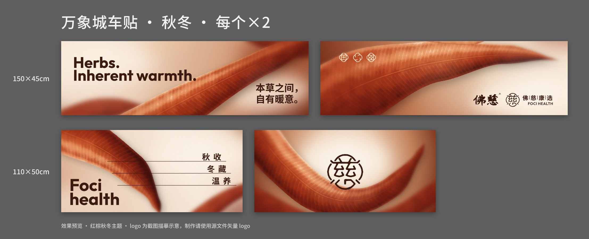

# 万象城 · 佛慈 柜体车贴 · 秋冬版

夏日版（绿色本草）换成秋冬版：**红棕色调背景 + 秋冬文案**，版式、logo 位置与夏日版保持一致。
贴在中岛柜下方柜门和侧板上（见 `assets/reference/cabinet-placement.jpg` 红框位置）。



## 尺寸与数量

| 编号 | 成品尺寸 | 内容 | 数量 |
|---|---|---|---|
| A | 150×45 cm | Herbs. Inherent warmth. / 本草之间，自有暖意。 | ×2 |
| B | 150×45 cm | 三个结纹图标 + 佛慈品牌组合 logo | ×2 |
| C | 110×50 cm | 秋收 / 冬藏 / 温养 + Foci health | ×2 |
| D | 110×50 cm | 「慈」印章 logo 居中 | ×2 |

## 文件

| 路径 | 用途 |
|---|---|
| `output/backgrounds/bg_*.jpg` | **背景大图**，四边各含 2 cm 出血，1:1 约 102 dpi，RGB。用来替换夏日 AI 里的背景 |
| `output/pdf/*.pdf` | 完整稿 PDF：背景 + 已转曲文字 + logo，四边各 2 cm 出血，TrimBox = 成品尺寸。**AI 可直接打开** |
| `output/layered/*.svg` | 分层稿（Background / Text / Logo 三个图层），AI 可直接打开；背景图以相对路径链接 `../backgrounds/` |
| `output/preview/*.jpg` | 效果预览图（给客户看） |

## 秋冬文案

**A（150×45）**：英文和中文都沿用夏日版的句式，只把「凉」换成「暖」，前后两季能对上。

- 主推：`Herbs. / Inherent warmth.`　`本草之间，/ 自有暖意。`
- 备选：`Herbs. / Warmth within.`　`一味本草，/ 一冬温暖。`　`本草温润，/ 秋冬自安。`

**C（110×50）**：取自《黄帝内经》「春生夏长，秋收冬藏」，从秋写到冬，最后落在温养。

- 主推：`秋收 / 冬藏 / 温养`
- 备选：`润燥 / 温补 / 养藏`　`暖身 / 滋养 / 安冬`
- `Foci health` 不变

**B、D**：只有 logo，没有文案。

## 在 AI 里出源文件

**方式一（推荐，logo 用原版矢量）**：打开夏日源文件「万象城-1929夏日活动装饰-转曲.ai」

1. 把四个背景换成 `output/backgrounds/` 里对应的图。图片尺寸为成品四边各加 20 mm（150×45 用 1540×490 mm，110×50 用 1140×540 mm），左上角对齐画板左上角外 20 mm 处（x = −20 mm，y = −20 mm）。
2. 按上面的文案改字（位置参考 `output/preview/`）。
3. logo 改色：浅色区域用深棕 `#3B1A10`；B 稿左上角三个图标压在叶子上，改奶油色 `#F6E3C8`。
4. 转曲，另存为 `.ai`。

**方式二**：AI 直接打开 `output/pdf/*.pdf`（或 `output/layered/*.svg`），把其中的描摹 logo 换成源文件里的矢量 logo，另存为 `.ai`。打开后如果画板是含出血的尺寸，用画板工具四边各收 20 mm 即可。

**PS**：直接打开 PDF（分辨率设 100 ppi 以上），或把背景图拖进原 PS 文件替换。

## 注意

- **效果图里的 logo 是从夏日版截图描出来的，只能用来示意位置，不能直接印刷。** B 稿里「佛｜慈｜康｜选 / FOCI HEALTH」这一行是用思源黑体 / Outfit 重新排的，和原版字形不完全一样。出片前请换成源文件里的正版矢量 logo。
- 字体：英文 Outfit Bold（与夏日版的几何无衬线体接近），中文 思源黑体 Bold（Noto Sans SC）。PDF 和 SVG 里的文字已经转曲，不缺字体。如果要沿用夏日版的原字体，在 AI 里重新打字即可。
- 背景图是 RGB，出片前按印厂要求转 CMYK。红棕色转 CMYK 时基本不会偏色。
- 主要配色：叶片 `#8E3418` / `#B2552B` / `#D68C5B`，浅底 `#F6E7D6`，文字 `#3B1A10`。

## 重新生成

背景是程序生成的（WebGL 叶脉渲染 + 景深模糊 + 颗粒），参数都在 `src/bg.js` 的 `DESIGNS` 里，可以调叶子的位置、宽度、颜色和模糊程度。版式和文案在 `src/layout.py`。

```bash
# 需要 node + playwright(Chromium)，python3 + pillow fonttools uharfbuzz reportlab（描摹 logo 另需 potracer）
./build.sh                      # 默认 40 px/cm（约 102 dpi）
PX_PER_CM=30 ./build.sh         # 快速出小图
# logo 描摹（只有换参考截图时才需要重跑）：
python3 src/trace_logo.py assets/reference/summer-version.png assets/logo-preview
```
