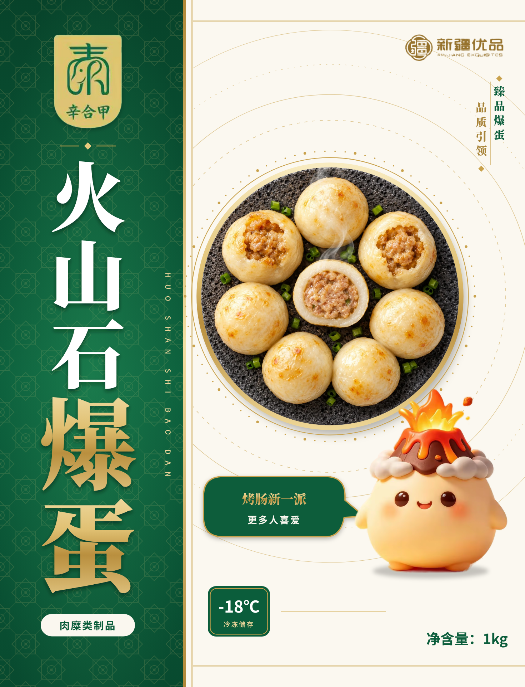
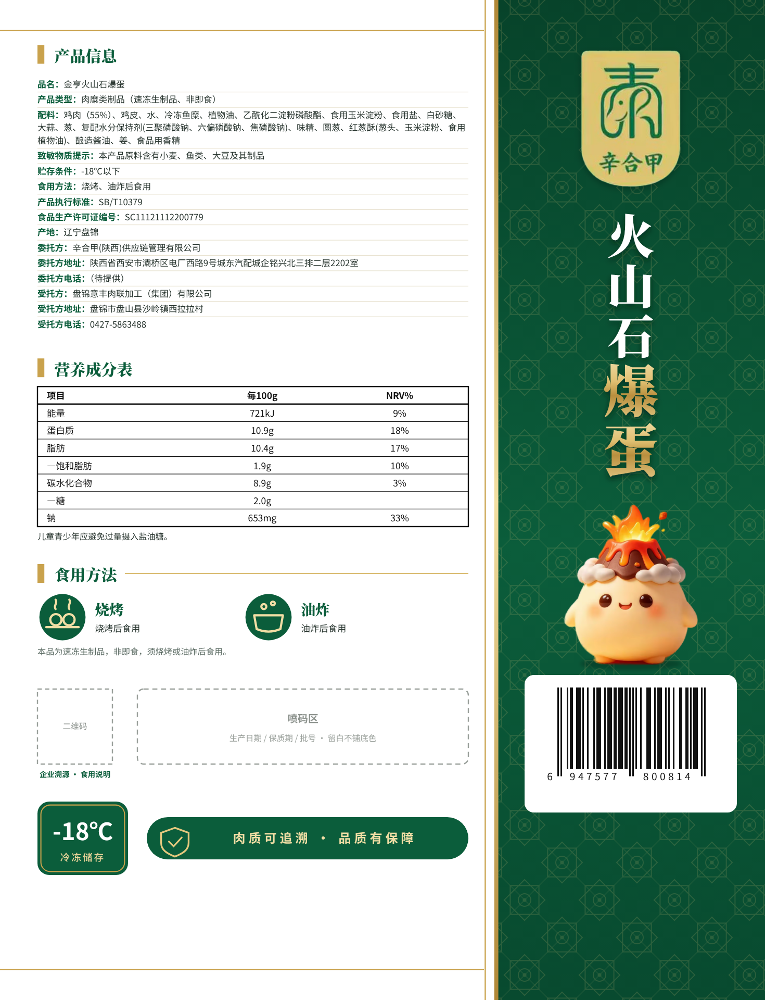
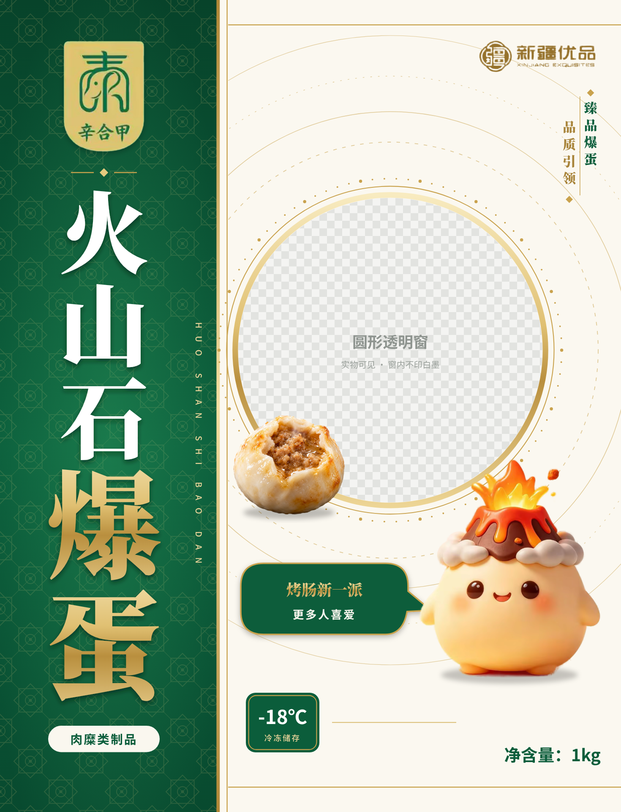
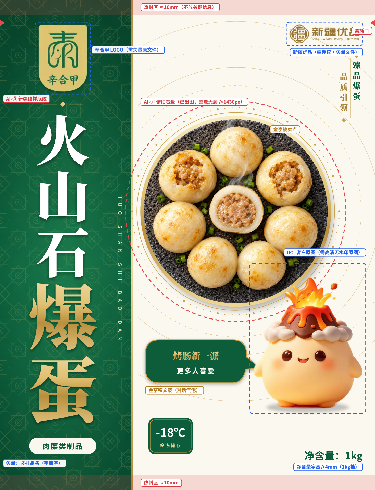
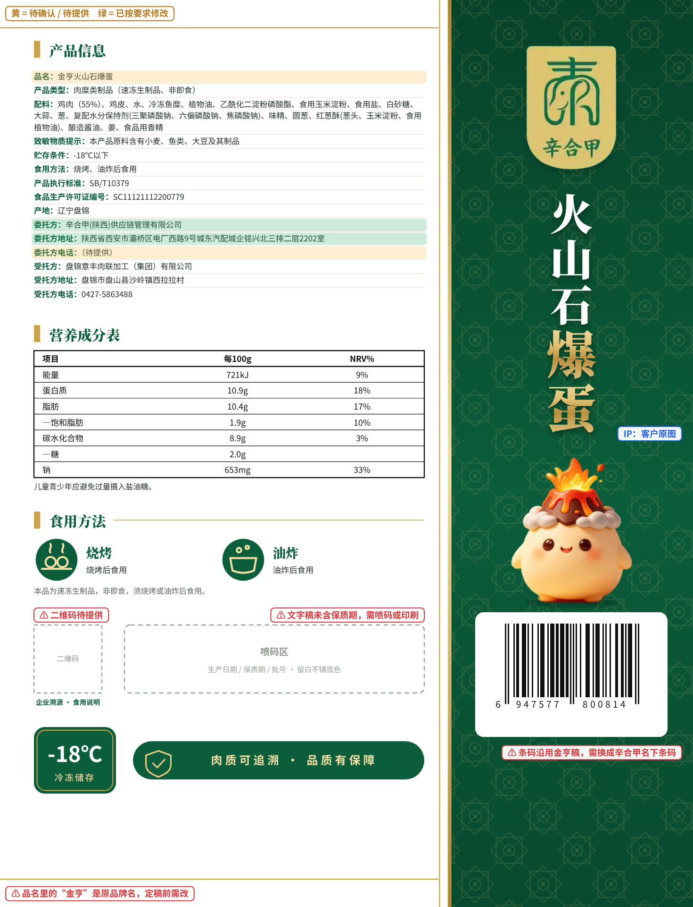

# 辛合甲 · 火山石爆蛋（1kg）白金绿包装方案 · 竖带版

上一版的结构还是参考图的套路（上绿下白、左上 LOGO、右上标识、居中大字、左下 -18℃、右下净含量），**本版从版式结构开始重新设计**。

内容沿用客户 10/21 的要求：
- 文字暂按《金亨火山石爆蛋.pdf》第 1 页，委托方改为辛合甲(陕西)供应链管理有限公司
- 换成辛合甲 LOGO
- 成品尺寸 245 × 320 mm
- IP 用客户提供的冒火胖娃娃原图，**已选定方案 B**（褐色火山 + 白色云朵圈）

| 正面 | 背面 | 正面 · 开窗版 | 正面 · 标注版 | 背面 · 标注版 |
|---|---|---|---|---|
|  |  |  |  |  |

> IP 是客户原图抠图后放上去的，没有重画。主图已换成用第 5 节提示词生成的**俯拍火山石盘**（AI-①）；开窗版窗边用的是**顶部爆开特写**（AI-②B）。
>
> AI 图清晰度：石盘图 1184px，印到 121mm 直径只有约 250dpi；定稿前用即梦“超清”或 Topaz 等放大到 ≥1430px（2 倍更稳）。爆开特写在包装上只有 44mm 宽，现有分辨率够用。切面特写（AI-②）暂时没用上，可以留作电商图、宣传图。

### IP：方案 B（已选定）

客户给的三张胖娃娃里选了方案 B：褐色火山 + 白色云朵圈 + 奶黄身体。原图抠图后直接使用，没有改形象。

原图只有 1080px，放到包装上（约 70×90mm）只有约 230dpi，而且带“AI生成”水印（抠图时已去掉）。定稿前请客户提供生成平台导出的**高清无水印原图**；拿不到的话，用第 5 节 AI-⑦ 以原图为参考重新出高清图。

> 标注版：红框 = AI 生成；蓝框 = 矢量 / 需原文件；背面黄底 = 待确认，绿底 = 已按要求修改。

---

## 1. 设计思路：「绿洲竖幅 · 金石圆盘」

| 元素 | 参考图（金亨 / 辛合甲旧稿 / 安井） | 本方案 |
|---|---|---|
| 版式结构 | 横向分割：上绿下白 / 上绿下灰 / 满版黄 | **左侧通高祖母绿竖带 + 右侧象牙白版面**，像一幅竖排的中式条幅 |
| 品名 | 横排大字，或两行右对齐 | **竖排书法感宋体**：“火山石”白色 35mm，“爆蛋”金色 46mm，贯穿整条竖带；旁边配一列竖排拼音 |
| 产品图 | 侧面看的堆叠、满碗或单颗切面 | **90° 俯拍的圆形火山石盘**：7 颗爆蛋围成一圈，正中一颗切开朝上，撒葱花芝麻；外圈是金色盘沿、点阵和热浪圈 |
| 卖点“臻品爆蛋品质引领” | 横条胶囊 | **竖排对联**：“臻品爆蛋 / 品质引领”两列错位排列 |
| 卖点“烤肠新一派 更多人喜爱” | 斜体大字 | **IP 的对话气泡**：由「火山爆爆」说出来 |
| IP | 金亨：维吾尔族小男孩 | 客户提供的**冒火胖娃娃**（方案 B：褐色火山 + 白云圈） |
| 开窗 | 大面积灰色开窗 | **圆形透明窗**，和石盘同一个位置 |
| 背面 | 常规上下排列 | **竖带移到右侧**，和正面竖带在袋子侧边相接，整袋像被一条绿带包住 |

**为什么用竖带**
- 冷柜里一排排包装大多是横向分割，竖幅更容易被认出来
- 竖排宋体自带中式、新疆“条幅”的庄重感，和辛合甲 LOGO 的书法气质一致
- 品名占满整条竖带，字可以做到 46mm，远看也清楚

## 2. 定稿前必须确认的事项

| # | 问题 | 说明 |
|---|---|---|
| 1 | **品名还是“金亨火山石爆蛋”** | 按“文字先按金亨的做”保留了原文。换成辛合甲 LOGO 后必须改，例如“辛合甲火山石爆蛋” |
| 2 | **委托方电话** | 只给了新的名称和地址，原电话属于新疆亚盛格，稿中写“（待提供）” |
| 3 | **条码 6947577800814** | 沿用金亨稿。委托方换成辛合甲后，一般要用辛合甲名下注册的条码 |
| 4 | **保质期** | 文字稿里没有保质期，喷码区已预留 |
| 5 | **二维码** | “企业溯源 · 食用说明”的二维码待提供 |
| 6 | **LOGO 原文件** | 辛合甲和新疆优品标志是从效果图里抠的，需要客户提供矢量文件；新疆优品需确认有使用授权 |
| 7 | **“爆蛋”与配料** | 配料中没有蛋类。GB 7718 规定新创名称易使人误解食品属性时，须在邻近位置用同一字号标示真实属性名称，建议先找当地市场监管部门确认。选定的 IP 方案 B 没有蛋壳造型，不会加深这个印象 |
| 8 | **IP 高清原图** | 已选定方案 B，需要客户提供高清无水印原图 |

## 3. 版面（245 × 320 mm，四周出血 3mm）

坐标以左上角为原点，单位 mm。

**正面**

| 区域 | 位置 | 内容 |
|---|---|---|
| 热封区 | 上 y 0–9.6，下 y 310–320 | 金细线标示，不放关键信息；两侧 y≈15 易撕口 |
| 竖带 | x 0–86（通高） | 祖母绿 + 新疆八角星纹样，右边缘是双金线 |
| 品牌 | x 25–57，y 16–60 | 辛合甲 LOGO |
| 竖排品名 | x 18–64，y 74–279 | 火山石（白）+ 爆蛋（金渐变），右侧竖排拼音 |
| 属性名称 | x 19–63，y 286–296 | 肉糜类制品 |
| 区域标识 | x 189–235，y 16–28 | 新疆优品（深金色版本） |
| 竖排卖点 | x 222–236，y 37–79 | 臻品爆蛋 / 品质引领 |
| 火山石盘 | 圆心 (154, 138)，盘径 118，含金圈约 135 | 俯拍主图 |
| 对话气泡 | x 95–170，y 222–250 | 烤肠新一派 / 更多人喜爱 |
| IP | x 165–237，y 175–267 | 客户原图（方案 B），火焰压在石盘金圈上 |
| 底部 | y 273–300 | 左：-18℃ 冷冻储存；右：净含量：1kg（字高 6.6mm，法规要求 ≥4mm） |

**背面**：右侧竖带（x 159–245）放 LOGO、竖排品名、IP 和条码；左侧白区从上到下依次是：
- 产品信息（金亨稿全文，委托方已改）
- 营养成分表
- 食用方法（烧烤 / 油炸）
- 二维码和喷码区
- -18℃ 标识和“肉质可追溯 · 品质有保障”

**开窗版**：石盘位置改为直径 120mm 的圆形透明窗，保留金色盘沿和点阵圈，窗内不印白墨。窗口左下角压一颗顶部爆开的爆蛋（AI-②B），补上透过窗口看不到的内馅。

## 4. 配色

| 色名 | HEX | CMYK 参考 | 用途 |
|---|---|---|---|
| 祖母绿 | `#0B5D3B` | C88 M42 Y92 K35 | 竖带、气泡、标识、文字 |
| 深墨绿 | `#07432A` | C90 M50 Y90 K55 | 竖带渐变 |
| 香槟金 | `#C9A24D` | 专色金：沿用金亨稿的 PANTONE 876 C，或用 871 C | “爆蛋”二字、金线、盘沿、点阵 |
| 深金 | `#A8843A` | C30 M45 Y85 K10 | 白底上的金色小字、新疆优品 |
| 浅金 | `#EAD49A` | C10 M16 Y45 K0 | 竖带上的拼音、细字 |
| 象牙白 | `#FBF8F0` | 白墨 + 极淡暖色 | 右侧版面底色 |
| 火焰橙（点缀） | `#FF8A2A` → `#FFC64A` | — | 只用在 IP 的火焰和岩浆上，面积 <3% |

## 5. AI 绘画部分与提示词

### 5.0 通用规则

1. **AI 只出图片，不出字**：品名、LOGO、卖点、法规文字全部用字库排版
2. **爆蛋要画成实物的样子**：AI 默认会画成鸡蛋或深金黄的炸丸子。按 5.1 的外观要点写提示词，并用实物图垫图
3. **光源统一**：都用“左上方柔光 + 暖调”
4. **背景便于抠图**：石盘、IP 用纯白底，热气用纯黑底
5. **分辨率**：300dpi。石盘直径约 120mm，至少需要 1420 px；IP 约 70×100mm，至少需要 830×1180 px。建议都生成 2048px 以上
6. 中文提示词适合即梦、可灵、通义万相、LiblibAI；英文适合 Midjourney、Flux、SD（`--v 7` 可换成当前最新版本）

### 5.1 爆蛋外观要点（按客户给的实物图）

| 部位 | 实物样子 | 参考色 |
|---|---|---|
| 外皮 | 乳白到浅奶黄色，光滑、微微鼓起；表面有不规则的浅金色斑驳纹（像炸鱼丸），烤过的地方有零星浅金焦斑，微油亮。**不是**深金黄，不是面包糠，不是芝麻球 | 底色 `#EBDDB0`，斑纹 `#D9A85A` |
| 切面 | 一圈**较厚**的洁白 Q 弹外皮（约占半径的 1/3），最外缘一条细细的浅金色 | `#F2EAD2` |
| 肉馅 | 粉褐到金褐色，颗粒感明显的肉糜，湿润带汁 | `#B86E3E` |
| 爆开 | 烤到顶部鼓起、爆开一个不规则的口子，**像火山口**，露出油亮的肉馅和琥珀色汤汁 | 汤汁 `#C98A3A` |

“爆开像火山口”正好对上“火山石爆蛋”这个名字。所以主图里除了对半切开的那颗，再放一两颗顶部爆开的。

**参考图怎么用**
- **即梦 / 可灵 / 通义万相**：把客户的实物图（顶部爆开那张）上传为参考图（垫图），参考强度 50–65%。太高会把绿色背景也带进来
- **Midjourney**：参考图链接放在提示词最前面，加 `--iw 1.5`；只想借色调就用 `--sref`
- **安井那张**是别家的效果图，只参考外皮和切面的样子，不要拿来垫图照搬构图

### AI-① 俯拍火山石盘（主图）· 1:1 · 纯白底 · ✅ 已出图

```
商业美食摄影，正上方90度垂直俯拍。一块正圆形的深灰色天然火山石圆盘，表面布满细密气孔，质感粗粝；盘中7颗圆球形爆蛋（直径约4厘米的肉馅丸子）均匀围成一圈，外皮乳白到浅奶黄色，光滑微鼓，带不规则的浅金色斑驳纹理，局部有零星烤出的浅金色焦斑，微微油亮；其中两颗顶部受热爆开一个不规则的小口，像小火山口，露出里面油亮的金褐色肉馅；正中央一颗对半切开、切面朝上，一圈较厚的洁白Q弹外皮包着粉褐色、颗粒感明显的肉糜馅，馅料湿润带汁；缝隙里撒少量翠绿葱花，一缕白色热气从中间升起。纯白色背景，圆盘完整居中、四周留白，左上方柔光，色调温暖清淡，盘子下方有柔和投影，超高清细节，8K
```
负面词：`深金黄色，炸得焦黄，焦黑，面包糠，芝麻球，汤圆，包子，奶黄包，鸡蛋，蛋黄，蛋壳，溏心，文字，水印，logo，手，筷子，侧面视角，透视变形，椭圆盘，卡通，塑料感，过度饱和，杂乱背景，模糊`

```
Commercial food photography, perfect 90-degree top-down flat lay. A perfectly round dark-grey natural volcanic lava stone plate with fine porous rough texture. Seven round Chinese "bao dan" meat-stuffed balls (4 cm) arranged evenly in a ring: pale ivory to light cream-yellow skin, smooth and slightly puffed, with irregular light-golden mottled marbling like fried fish balls and a few faint golden grill spots, light oily sheen. Two balls have burst open at the top from the heat, an irregular small opening like a tiny volcano crater revealing glossy golden-brown meat filling. The center ball is cut in half with the cut face up: a thick bright-white springy outer layer wrapping a pinkish-tan coarse minced-meat filling, moist and juicy. A few fresh green scallion rings in the gaps, a thin wisp of steam. Pure white background, plate fully visible and centered with margin, soft light from upper left, warm and light color tone, soft shadow beneath, ultra detailed --ar 1:1 --style raw --s 120 --v 7 --no dark golden crust, breadcrumbs, sesame balls, tangyuan, bun, egg, egg yolk, text, logo, hands, chopsticks, side view, perspective, oval plate, cartoon, oversaturated
```
后期：抠成正圆，外面加金色盘沿和点阵圈（矢量）。

### AI-①B 侧视火山石板（备选主图 / 宣传图）· 3:2 · 纯白底

```
商业美食摄影，45度侧俯拍。一块深灰色多孔火山石板上放着5颗圆球形爆蛋，外皮乳白到浅奶黄色，光滑微鼓，带浅金色斑驳纹；最前面一颗顶部烤得爆开一个不规则的口子，像火山口，金褐色肉馅和琥珀色汤汁微微溢出；旁边一颗对半切开，露出厚厚的洁白外皮和粉褐色颗粒肉馅；几缕热气升起，旁边点缀两片翠绿葱叶。纯白背景，左上方柔光，色调温暖清淡，浅景深，超高清，8K
```
负面词同 AI-①（把“侧面视角，透视变形”去掉）。

### AI-② 切面特写 · 1:1 · 纯白底 · ✅ 已出图（备用）

俯拍图正中那颗的切面不够好看时，单独生成一颗，再合成到盘心。

```
微距美食摄影，单颗爆蛋对半切开，切面朝向镜头、略微倾斜：外皮乳白到浅奶黄色，表面带浅金色斑驳纹；切面是一圈较厚的洁白Q弹外皮（约占半径三分之一），最外缘一条细细的浅金色，中心是粉褐色、颗粒感明显的肉糜馅，湿润带汁，微微冒热气；纯白背景，左上方柔光，超高清，8K
```
负面词：`鸡蛋，蛋黄，溏心蛋，深金黄色，焦黑，面包糠，生肉，血水，文字，水印，刀，盘子，模糊`

```
Macro food photography, a single Chinese "bao dan" meat ball sliced in half, cut face toward the camera slightly tilted: pale ivory to light cream-yellow skin with light-golden mottled marbling; the cut face shows a thick bright-white springy outer layer (about one third of the radius) with a thin light-golden rim, and a pinkish-tan coarse minced-meat filling in the center, moist and juicy, faint steam. Pure white background, soft light from upper left, ultra detailed --ar 1:1 --style raw --v 7 --no egg, egg yolk, dark golden crust, breadcrumbs, raw meat, text, knife, plate
```

### AI-②B 顶部爆开特写 · 1:1 · 纯白底 · ✅ 已出图（用在开窗版）

对应客户实物图里顶部爆开的那颗，可以用在盘心，也可以单独做宣传图。

```
美食微距摄影，45度俯拍，单颗爆蛋在火山石上烤到顶部爆开：乳白色外皮微微鼓起，边缘带浅金色烤斑；顶部裂开一个不规则的圆口，像小火山口，口内是油亮的金褐色颗粒肉馅，琥珀色汤汁在口里打转、微微溢到边缘，冒着细细的热气；纯白背景，左上方柔光，超高清，8K
```
负面词：`鸡蛋，蛋黄，溏心蛋，蛋挞，深金黄色，焦黑，面包糠，文字，水印，手，筷子，模糊`

```
Macro food photography, 45-degree high angle, a single Chinese "bao dan" meat ball grilled on volcanic stone until its top bursts open: pale ivory skin slightly puffed with light-golden grill spots; an irregular round opening at the top like a tiny volcano crater, filled with glossy golden-brown coarse meat filling and swirling amber juice slightly overflowing the rim, thin wisps of steam. Pure white background, soft light from upper left, ultra detailed --ar 1:1 --style raw --v 7 --no egg, egg yolk, egg tart, dark golden crust, breadcrumbs, text, hands, chopsticks
```

### AI-③ 新疆纹样底纹（竖带用）· 1:1 · 无缝

```
新疆传统纹样无缝四方连续图案，以八角星花为中心，结合卷草纹与巴旦木纹的几何构成，金色细线描（#C9A24D）画在深祖母绿底（#0B5D3B）上，平面矢量线稿风格，左右对称，线条粗细均匀，图案疏朗，低对比度，高级典雅
```
```
Seamless repeating pattern, traditional Xinjiang Central Asian ornament, eight-pointed star rosettes linked by arabesque scrolls and badam paisley motifs, fine thin gold line art (#C9A24D) on deep emerald green (#0B5D3B), flat vector line drawing, symmetrical, uniform line weight, airy spacing, subtle and elegant --tile --ar 1:1 --style raw --v 7 --no shading, gradient, 3d, text
```
后期：在 Illustrator 里用“图像描摹”转成矢量，透明度 12–18%。

### AI-④ 热气 · 2:3 · 纯黑底

```
几缕白色热气蒸汽缓缓上升，柔和半透明，形态自然弯曲，纯黑色背景，高清摄影素材，画面中没有其他物体
```
后期：PS 图层模式选“滤色”，叠在盘心上方，透明度 40–60%。

### AI-⑥ 整袋效果图（提案用）

```
一个空白无图案的光面塑料食品包装袋样机，竖版三边封软包装，袋面饱满，带自然褶皱与高光反射，顶部有锯齿封口，立放在白色大理石台面上，背景为明亮的现代白色厨房虚化，左侧窗户自然光，清新高级，商业产品摄影，8K
```
然后在 PS 里用“智能对象”把 `preview/front.png` 贴上去。

### AI-⑦ IP 高清重出（拿不到原图时用）

IP 定为客户原图，**不要改形象**。只有拿不到高清原图，或者需要别的动作时，才用这一节：
- 把选中的那张原图上传为“角色参考 / 垫图”，参考强度调高
- 下面的提示词只用来补全细节和提高分辨率

下面的提示词按方案 B 原图描述：白色云朵圈 + 褐色火山。

```
3D卡通IP形象设计，一个圆滚滚胖乎乎的小团子角色，身体是奶黄色，表面光滑软萌，略带哑光质感；头顶有一圈白色云朵，云朵中间冒出一座深褐色小火山，火山表面有火山石气孔质感，火山口流淌着橙金色岩浆，顶部喷出金黄到橙色的火焰，周围飞溅几颗小火山石碎块和金色火星；黑亮的大圆眼睛带高光，粉色腮红，张嘴开心地笑，短短的小手，两只小脚；全身站立，泡泡玛特盲盒手办风格，C4D渲染，柔和棚拍灯光，左上方主光，纯白背景，高清，8K
```
负面词：`文字，水印，AI生成字样，紫色，恐怖，尖牙，多余手指，畸形，肢体错乱，背景杂物，模糊`

```
3D cartoon mascot character design, a chubby round little dumpling creature with a creamy yellow body, smooth soft vinyl-toy texture with slight matte finish; a ring of fluffy white clouds sits on top of its head, and a small dark-brown volcano with porous lava-stone texture rises from the middle of the clouds, glowing orange-gold lava dripping from the crater, golden-to-orange flames bursting out, tiny volcanic rock bits and golden sparks flying; big glossy black eyes with highlights, pink blush cheeks, happy open-mouth smile, tiny arms, two little feet; full body standing, Pop Mart blind box figure style, C4D octane render, soft studio lighting from upper left, pure white background --ar 1:1 --style raw --v 7 --no text, watermark, purple, scary, teeth, extra fingers, extra limbs
```

**动作变体**（加在提示词末尾）：
- 正面（配对话气泡）：`身体四分之三侧向左边，一只小手抬起像在说话，嘴巴张开，开心地介绍`
- 背面竖带：`正面站立，一只小手举起打招呼，眨一只眼`

先定一张满意的图，再用它做角色参考（Midjourney `--cref`、即梦“角色参考”）生成其他动作，形象才能保持一致。
如果要注册 IP 或商标，建议由设计师在 AI 图基础上重绘定稿。

## 6. 印刷与材质

- **材质**：NY/PE 或 PET/PE 复合（耐 -18℃ 以下低温、抗穿刺），1kg 装总厚一般 100–120μm，和彩印厂确认
- **印刷**：凹版印刷，金色用专色金（PANTONE 876 C / 871 C）
- **表面**：整体哑光油；竖排品名、石盘、IP 局部亮光
- **竖带接缝**：正面左侧竖带和背面右侧竖带在侧封边相接，制版时两边的绿色、纹样要对齐，侧封处不要放文字
- **白墨**：透明膜先铺白墨，开窗区不铺
- **文件**：CMYK + 专色单独通道；文字转曲；图片 ≥300dpi；出血 3mm；热封区、撕口、喷码区按彩印厂刀版

## 7. 法规自查（以现行国标和当地市场监管要求为准）

- [ ] 正面品名“火山石爆蛋”和真实属性名称“肉糜类制品”在同一版面（“爆蛋”问题见第 2 节第 7 条）
- [ ] 净含量在主展示版面，字高 ≥4mm（本稿 6.6mm）
- [ ] 委托方、受托方的名称、地址、联系方式齐全（委托方电话待补）
- [ ] 生产日期、保质期（待补）
- [ ] 致敏物质提示、营养成分表：按金亨稿，含饱和脂肪、糖和“儿童青少年应避免过量摄入盐油糖。”
- [ ] 产品类型写明“速冻生制品、非即食”，食用方法“烧烤、油炸后食用”
- [ ] 条码归属辛合甲，不放在热封区和褶皱处

## 8. 文件说明

```
packaging/huoshanshi-baodan/
├── README.md                 本文档
├── layout.html               交互排版稿（标准 / 标注 / 开窗）
├── svg/front.svg             正面矢量底稿 245×320mm（可导入 Illustrator）
├── svg/back.svg              背面矢量底稿 245×320mm
└── preview/                  5 张预览图（正背面、开窗版、两张标注版）
```
